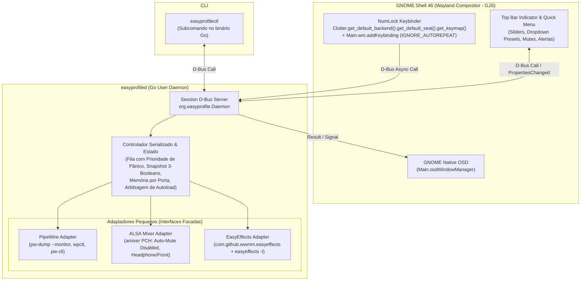

# EasyProfileApp — Documento de Requisitos de Software (DRS), Arquitetura e System Design (v2 — Pós-Auditoria Cruzada)

- **Data:** 18/10/2026 (`America/Sao_Paulo`)
- **Status:** Requisitos e Arquitetura Consolidados após Grill-Me + Auditoria Cruzada Independente (Codex + Hermes)
- **Ambiente Alvo:** Ubuntu 24.04.5 LTS, GNOME Shell 46.0 (Wayland), PipeWire 1.0.5, WirePlumber 0.4.17, EasyEffects 7.1.6 (APT)

---

## 1. Visão Geral e Resumo das Decisões Consolidadas

O **EasyProfileApp** é uma ferramenta pessoal de controle rápido, previsível e seguro de áudio sobre o ecossistema **PipeWire + ALSA + EasyEffects**, projetada para o setup aprovado do usuário (**Microfone USB KA-1333**, **Headphone AKG K52** na saída frontal e **Caixas 2.1 Multi SP166** na saída traseira da placa integrada Realtek ALC887-VD).

### 1.1 Matriz de Decisões Fechadas (Grill-Me + Correções da Auditoria Técnica)

| Tema | Decisão Confirmada e Revisada |
|---|---|
| **Alcance do Produto** | Ferramenta pessoal otimizada para este setup (Ubuntu 24.04 / GNOME 46), com identidades de hardware, rotas, limites e presets desacoplados em arquivo de configuração (`config.json`). |
| **Stack & Único IPC** | **Go (Single-Binary Daemon + CLI)** + **GJS (Extensão nativa GNOME Shell 46)** comunicando exclusivamente via **Session D-Bus (`org.easyprofile.Daemon`)** (removida a duplicidade de Unix Socket). |
| **Interfaces de Usuário** | 1. **Atalhos no Numpad** (quando `NumLock = ON`) + **OSD Nativo do GNOME**.<br>2. **Indicador e Menu no Topo do GNOME Shell (Top Bar / Quick Settings)** com sliders de volume/mic, botões de rota/mute, alerta de mic cru e **dropdown de presets**.<br>3. **CLI rápida** (`easyprofilectl`). |
| **Destinos de Saída (MVP)** | Alternância exclusiva entre **AKG K52** (`analog-output-headphones`) e **Caixas SP166** (`analog-output-lineout`) na placa `alsa_card.pci-0000_00_1f.3`. Pré-condição verificada: **`Auto-Mute Mode` = `Disabled`** no ALSA, e porta inativa explicitamente mutada (`Headphone` vs `Front`). |
| **Política de Volume de Saída e Bloqueador `monitor.channel-volumes`** | **Achado Crítico da Auditoria:** No EasyEffects 7.1.6 / PipeWire 1.0.5, `easyeffects_sink` e `easyeffects_source` possuem `monitor.channel-volumes = false` por padrão (suas portas de saída são portas de monitor, onde `channelVolumes`/`mute` comuns do nó não atenuam o som sem essa propriedade ou sem atuar nas `monitorVolumes`/nó físico).<br>- **Política:** Passo de **2%** de `0%` a `100%`, lembrando o último volume usado em cada porta durante a sessão e respeitando o teto físico calibrado (**97% no AKG**, **100% nas Caixas**).<br>- **Contrato da Slice EP-002 (Spike antes do domínio definitivo):** Comprovar e fixar o mecanismo real de atenuação/mute (ex: habilitar `monitor.channel-volumes` / `monitorVolumes` vs controlar o ganho/mute efetivo no ponto correto do grafo) e padronizar a escala (`wpctl` cúbica vs linear). |
| **Política de Nível do Microfone** | Controle atua **após a cadeia de filtros DSP** de `0%` a `100%` com **passo de 2%**, mantendo o ganho físico USB do KA-1333 intocado para nunca descalibrar Speex/Gate/Compressor/De-Esser/Limiter. |
| **Política de Mute de Microfone** | **Dual-Mute de Privacidade:** atua tanto na fonte virtual (`easyeffects_source`) quanto na fonte física USB (`alsa_input.usb-MU900_KA-1333...`). Sucesso exige readback confirmado dos dois alvos; falha parcial é reportada como proteção incompleta (`degraded_partial_mute`). |
| **Mute Conjunto (Pânico) — Snapshot de 3 Booleans** | Tecla `Numpad Enter`. **Correção da Auditoria:** O snapshot de pânico preserva separadamente **`{SavedOutMute, SavedMicVirtualMute, SavedMicPhysicalMute}`** (nunca reduzindo o mic a um único booleano que poderia desmutar o mic físico indevidamente ao sair do pânico!).<br>- **Prioridade e Override Manual:** O comando de Pânico tem prioridade imediata na fila. Se durante o Pânico o usuário acionar manualmente `[0]` (Mute Mic) ou `[.]` (Mute Saída), a escolha manual vence e **atualiza o campo correspondente do snapshot**; quando o usuário apertar `[Enter]` depois para sair do Pânico, o sistema restaura o outro canal e mantém o canal alterado manualmente exatamente como o usuário deixou. |
| **Monitor de Mic Cru (Stream Guard)** | Inspeciona links ativos no grafo PipeWire (excluindo nós internos do EasyEffects). Se um aplicativo real conectar ao `alsa_input` físico do KA-1333, exibe alerta na Top Bar com ação manual de migração via metadata do WirePlumber (`target.object` / `target.node`) com confirmação dos novos links. **Sem automigração cega no MVP.** |
| **Numpad & Modo Áudio (`NumLock`)** | A tecla **`NumLock`** é a chave **Modo Áudio ON/OFF** (com ícone na Top Bar), monitorada via `Clutter.get_default_backend().get_default_seat().get_keymap()` (`notify::num-lock-state`).<br>- Ações de toggle (`0`, `.`, `Enter`, `1`, `2`, `3`, `5`) usam a flag nativa **`Meta.KeyBindingFlags.IGNORE_AUTOREPEAT`** do GNOME Shell 46.<br>- As teclas sem função atribuída no Numpad (**`4`, `6`, `7`, `8`, `9`**) também são interceptadas como **No-Op silencioso** quando `NumLock = ON`, impedindo que esbarrar nelas digite números acidentais no código/terminal. |
| **Múltiplos Presets por Saída & Arbitragem de Autoload** | Seleção de presets adicionais via **Dropdown na UI da Top Bar**, filtrando presets compatíveis com a porta ativa (`AKG` vs `SP166`/`Caixas`).<br>- **Memória de Sessão vence o Autoload:** se o usuário escolheu `"AKG - Rock"` no dropdown, trocou para as Caixas e voltou para o AKG na mesma sessão, o daemon aguarda/reconcilia o evento de autoload do EasyEffects e reaplica `"AKG - Rock"` (confirmando em `com.github.wwmm.easyeffects` → `last-used-output-preset`, `plugins` ativos e `bypass=false`). Só volta para o padrão diário ao apertar `[5] Reset` ou em novo Login. |
| **Política de Login e Identidade da Sessão Gráfica** | - **No Login:** inicia na porta ativa com Preset Padrão Diário, volume `95%` (teto físico da porta), mic `100%`, e Saída/Mic **Desmutados**.<br>- **Identificação de Sessão (Correção da Auditoria):** A trava de "já inicializado no login" vincula o identificador real da sessão gráfica (`XDG_SESSION_ID` / `GNOME_SHELL_SESSION_MODE` / boot ID do bus D-Bus de sessão) para que reiniciar o daemon não repita o desmute de login, mas um novo login gráfico aplique a política corretamente.<br>- **Na Tecla `[5]` (Reset Base):** restaura Preset Padrão Diário + volumes base (`95%` saída / `100%` mic), mas **NÃO desmuta o microfone** se estiver mutado. |
| **Segurança dos Guards em Produção** | Os serviços atuais (`ka1333-input-guard.service` e `easyeffects-output-guard.service`) permanecem **ativos e intocados** durante todo o desenvolvimento. No cutover final (`EP-006`), o instalador grava o estado prévio exato (`is-enabled` / `is-active`) de cada unidade para que o rollback restaure exatamente o estado original. |

---

## 2. Mapa Oficial de Teclas no Numpad (Modo Áudio = `NumLock ON`)

Todas as 17 teclas do bloco numérico são capturadas quando `NumLock = ON` para garantir zero vazamento de caracteres na janela ativa:

```text
┌───────────┬───────────┬───────────┬───────────┐
│  NumLock  │     /     │     *     │     -     │
│ MODO ÁUDIO│ Mic -2%   │ Mic +2%   │ Vol -2%   │
│  ON / OFF │ (Repeat)  │ (Repeat)  │ (Repeat)  │
├───────────┼───────────┼───────────┼───────────┤
│     7     │     8     │     9     │           │
│ [No-Op /  │ [No-Op /  │ [No-Op /  │     +     │
│ Silencioso│ Silencioso│ Silencioso│ Vol +2%   │
├───────────┼───────────┼───────────┤ (Repeat)  │
│     4     │     5     │     6     │           │
│ [No-Op /  │   RESET   │ [No-Op /  │           │
│ Silencioso│  PADRÃO   │ Silencioso│           │
├───────────┼───────────┼───────────┼───────────┤
│     1     │     2     │     3     │           │
│   FONE    │  CAIXAS   │  ALTERNAR │   Enter   │
│  AKG K52  │   SP166   │ AKG⇄CAIXAS│MUTE TOTAL │
├───────────┴───────────┼───────────┤ (PÂNICO)  │
│           0           │  . / ,    │           │
│       MUTE MIC        │MUTE SAÍDA │           │
│     (Dual-Mute)       │           │           │
└───────────────────────┴───────────┴───────────┘
```
- **Com `Meta.KeyBindingFlags.IGNORE_AUTOREPEAT`:** `0`, `.`/`,`, `Enter`, `1`, `2`, `3`, `5` e as teclas bloqueadas `4`, `6`, `7`, `8`, `9`.
- **Com suporte a repetição (Coalescência no Daemon):** `+`, `-`, `*`, `/`.

---

## 3. Arquitetura Enxuta e Pragmática

### 3.1 Componentes e Único IPC (Session D-Bus)



### 3.2 Simplificação Estrutural (Eliminando Overengineering)

Atendendo à auditoria técnica:
1. **Sem proliferar classes ou Ports ornamentais:**
   - Removemos `SessionStorePort` e `OSDNotifierPort` do núcleo. A extensão GJS exibe o OSD diretamente ao receber a confirmação/sinal D-Bus do daemon.
   - `OutputDestination` é uma struct de configuração validada com o filtro de presets compatíveis.
   - O `Controller` concentra de forma coesa o estado desejado, o estado observado e as invariantes de negócio.
2. **Contratos Técnicos Corrigidos:**
   - **Proteção na Troca de Rota (`SwitchDestination`):** Como `easyeffects_sink` tem `monitor.channel-volumes = false`, a proteção de silêncio durante a transição de rota atua diretamente **no nó físico (`alsa_output`) e nos pinos ALSA (`amixer`)** (além do ponto validado no Spike EP-002), garantindo silêncio real no hardware antes de comutar `analog-output-headphones` ↔ `analog-output-lineout`.
   - **Confirmação de Preset no EasyEffects 7.1.6:** Lê a chave `last-used-output-preset` no schema raiz `com.github.wwmm.easyeffects` (e `last-used-input-preset` para o mic), verifica se o booleano global `bypass` é `false` e rejeita colisão de nomes entre direções (`input/` vs `output/`).
   - **Arbitragem entre Memória de Sessão e Autoload:** Ao trocar para uma porta cujo preset escolhido na sessão difere do preset de autoload (ex: usuário escolheu `"AKG - Rock"`), o controlador observa a transição do autoload após a mudança de rota (ou aguarda a janela de estabilização do EasyEffects) e aplica `"AKG - Rock"`, confirmando via GSettings monitor que o preset final estabilizou em `"AKG - Rock"`.
   - **Snapshot de Pânico com 3 Estados Independentes:**
     ```go
     type PanicSnapshot struct {
         Active              bool
         SavedOutMute        bool
         SavedMicVirtualMute bool
         SavedMicPhysicalMute bool
     }
     ```
     Se o microfone físico estava mutado e o virtual desmutado antes do pânico, sair do pânico restaura exatamente `Virtual=false, Physical=true`, **jamais desmutando um pino físico que estava mutado antes do pânico**. E se o usuário alterar manualmente o mute de saída ou do mic durante o pânico, o snapshot daquele canal é atualizado in-place.

---

## 4. Roadmap Reordenado: Spikes e Descoberta Antes do Domínio Definitivo

A ordem das 6 Slices foi invertida nas fases iniciais para **provar primeiro os contratos de hardware e Wayland** antes de consolidar o domínio e o daemon:

| Slice | Título | Escopo | Toca no Áudio Real? |
|---|---|---|---|
| **EP-001** | **Inventário Passivo Read-Only + Spike `NumLock`/Numpad (Sem Áudio)** | 1. CLI de diagnóstico passivo (`easyprofilectl inspect`) que lê o grafo PipeWire real (`monitor.channel-volumes`, escalas, rotas, `Auto-Mute Mode`, schemas GSettings do EasyEffects) sem alterar nada.<br>2. Protótipo mínimo da extensão GJS validando `Clutter.get_default_backend().get_default_seat().get_keymap()`, `IGNORE_AUTOREPEAT`, bloqueio das 17 teclas do Numpad (incluindo `4/6/7/8/9` como No-Op) apenas em um contador/OSD, sem tocar no áudio. | **NÃO** (100% Read-Only no áudio) |
| **EP-002** | **Spikes Acompanhados de Áudio Real (Volume/Mute Efetivos, Mic Pós-DSP e Troca/Autoload)** | Com acompanhamento humano e restauração imediata (mantendo os 2 guards atuais ativos):<br>1. Testar e definir o ponto exato de controle de volume/mute de saída e do mic pós-DSP diante de `monitor.channel-volumes = false`.<br>2. Validar a troca `SP166 ↔ AKG` protegida por mute físico/ALSA e medir o tempo do autoload do EasyEffects para calibrar a arbitragem de preset de sessão. | **SIM** (Teste pontual acompanhado com restore imediato) |
| **EP-003** | **Domínio Enxuto, Parser Incremental e Testes de Regressão Baseados nos Spikes** | Implementação do `Controller` com invariantes reais provadas na EP-002 (Snapshot 3-booleans de Pânico, override manual durante pânico, Reset `[5]` preservando mute do mic, arbitragem de preset de sessão vs autoload, parser incremental do `pw-dump` tolerante a sufixo `.3`→`.4`). | **NÃO** (Testes 100% isolados em memória) |
| **EP-004** | **Daemon D-Bus, Adaptadores Reais/Fakes e Integração Isolada** | Servidor/Cliente D-Bus (`org.easyprofile.Daemon`), fila com prioridade para Pânico, reconciliação dos guards em modo observação, e suíte de integração usando fakes por construção + `GSETTINGS_BACKEND=memory` + `dbus-run-session` + bloqueio explícito de binários de áudio do host nos testes. | **NÃO** (Isolamento hermético) |
| **EP-005** | **UI Completa na Top Bar (GNOME Shell 46) + Integração Acompanhada** | Top Bar Indicator, botões AKG/Caixas, Dropdown de Presets filtrado por porta, sliders de Volume/Mic, botões de Mute/Pânico/Reset, alerta e migração manual de Stream Cru, integrada ao `easyprofiled`. | **SIM** (Sessão GNOME acompanhada) |
| **EP-006** | **Homologação de Login, Cutover Autorizado dos Guards e Rollback Verificado** | Validação da trava de sessão gráfica (`XDG_SESSION_ID`), medição real de CPU/RAM/latência para calibrar limites seguros no systemd (sem `CPUQuota=2%` agressivo que cause throttling), script de cutover que salva o estado prévio dos 2 guards antigos e script de rollback testado. | **SIM** (Cutover final autorizado) |
