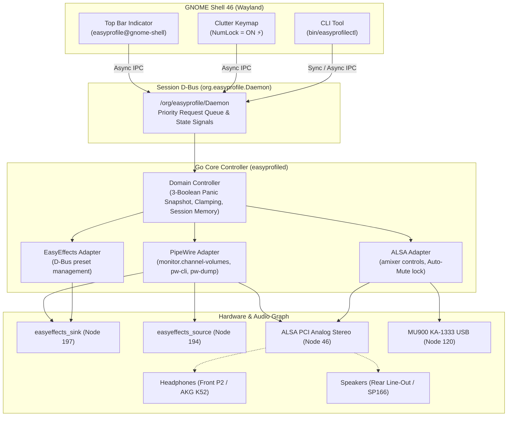

# EasyProfileApp 🎧⚡

[](#)
[](#)
[](#)
[](LICENSE)

> **Deterministic, pop-free audio profile orchestrator and hardware convenience controller for Linux.**  
> Seamlessly bridges **PipeWire 1.0.5**, **ALSA**, **EasyEffects 7.1.6**, and **GNOME Shell 46 (Wayland)** with acoustic safety, true USB microphone dual-mute, instant panic mute, and conditional numeric keypad (Numpad) control.

---

## 🌟 Highlights

- **🛡️ Acoustic Protection & Zero Pop/Crack Switching:**  
  Switch seamlessly between front-panel headphones (AKG K52) and rear speakers (Multi SP166). The daemon enforces a hardware-level ALSA and sink mute *prior* to switching card routes, zeroing out electrical spikes, pop sounds, and acoustic shock.
- **🎙️ True Hardware + Software Dual-Mute:**  
  Muting the microphone (KA-1333 USB) mutes both the DSP virtual source node (`easyeffects_source`) and the physical USB ALSA capture node simultaneously. Prevents background snooping or apps bypassing EasyEffects.
- **🚨 3-Boolean Emergency Panic Mute & State Restoration:**  
  One-key panic mute (`Numpad [3]` or CLI `panic`) instantly silences all output channels and microphone inputs. Restoring preserves the exact 3-state snapshot (`{SavedOutMute, SavedMicVirtualMute, SavedMicPhysicalMute}`), guaranteeing that an already-muted mic is never accidentally opened on panic release.
- **⚡ Wayland Numpad Audio Layer (Gated by `NumLock`):**  
  Uses native Clutter Seat keymaps to intercept numeric keypad keys *only* when `NumLock = ON` (indicated by `⚡` on the Top Bar). While active, volume `[+]`/`[-]`, mutes `[1]`, `[2]`, `[3]`, route switch `[0]`, and baseline reset `[5]` work seamlessly with native GNOME OSD feedback, while unused digits `[4, 6, 7, 8, 9]` are silently absorbed so numbers are never typed into active text windows. When `NumLock = OFF`, normal cursor navigation (arrows, Home, End, PgUp) is restored immediately.
- **🎛️ Native GNOME Shell 46 Top Bar Quick Menu:**  
  Compact indicator showing active destination icon and volume percentage. Clicking reveals a quick menu with route toggles, calibrated volume sliders, mic gain sliders, mute buttons, and a preset dropdown.
- **🏎️ Ultra-High Performance & Low Latency:**  
  Go daemon with in-memory state controller, zero busy-polling, bounded event coalescing, and a PipeWire dump parser benchmarked at **~2.8 ms** (sub-10ms hard budget, < 15 MB RAM).

---

## 🏛️ Architecture Overview



---

## ⌨️ Numpad Control Layer (When `NumLock = ON` ⚡)

| Key | Action | Behavior & Protection |
|---|---|---|
| `[+]` | **Volume Up (+2%)** | Increments output volume with GNOME OSD gauge. Repeatable. |
| `[-]` | **Volume Down (-2%)** | Decrements output volume with GNOME OSD gauge. Repeatable. |
| `[1]` | **Mic Dual-Mute Toggle** | Toggles both virtual DSP node and physical USB node simultaneously. |
| `[2]` | **Output Mute Toggle** | Toggles output mute on active destination. |
| `[3]` | **Emergency Panic Mute** | Instantly mutes all outputs and mic; toggles back with 3-state snapshot restoration. |
| `[0]` | **Route Toggle** | Switches between AKG K52 and SP166 with pop-free ALSA/sink mute protection. |
| `[5]` | **Daily Baseline Reset** | Restores calibrated baseline (95% output, base preset), **preserving microphone mute**. |
| `[4, 6, 7, 8, 9]` | **Silent No-Op** | Silently consumed to prevent typing stray numbers into editors or terminals. |
| `NumLock OFF` | **Navigation Mode** | Disables all audio interception; keys revert to standard arrows, Home, End, etc. |

---

## 🛠️ CLI Quick Reference (`easyprofilectl`)

```bash
# Check complete audio and daemon status
easyprofilectl status

# Adjust volume
easyprofilectl volume +2       # Step up 2%
easyprofilectl volume -2       # Step down 2%
easyprofilectl volume 95       # Set absolute volume (0-100%)

# Adjust post-DSP mic level
easyprofilectl mic +5
easyprofilectl mic 100

# Toggle mutes
easyprofilectl mute out        # Toggle output mute
easyprofilectl mute mic        # Toggle microphone dual-mute
easyprofilectl panic           # Toggle emergency panic mute

# Route and preset management
easyprofilectl route toggle    # Switch between AKG K52 and SP166
easyprofilectl route akg       # Explicitly select AKG K52
easyprofilectl route sp166     # Explicitly select SP166
easyprofilectl preset list     # List presets compatible with active destination
easyprofilectl preset "AKG - Rock" # Apply specific preset

# Reset to daily calibrated baseline
easyprofilectl reset

# Passive real-time read-only inspection (no daemon required)
easyprofilectl inspect
```

---

## 🚀 Building & Running

### Requirements
- **OS:** Linux (Ubuntu 24.04 LTS tested)
- **Desktop:** GNOME 46 (Wayland)
- **Audio Stack:** PipeWire 1.0.5+, WirePlumber 0.4.17+, EasyEffects 7.1.6 (APT package)
- **Toolchain:** Go 1.23+

### Build from Source

```bash
# Clone the repository
git clone https://github.com/Rafael-Albernaz-dev/easy-profile-app.git
cd easy-profile-app

# Compile binary and pack GNOME extension
make build

# Run all 6 strict quality gates (linters, -race unit tests, isolated D-Bus integration, benchmarks)
make quality-gate
```

### Install GNOME Extension

```bash
# Install and compile schemas
gnome-extensions install --force dist/easyprofile@gnome-shell.shell-extension.zip
glib-compile-schemas ~/.local/share/gnome-shell/extensions/easyprofile@gnome-shell/schemas

# Enable extension
gnome-extensions enable easyprofile@gnome-shell
```
*(Note: On GNOME Shell Wayland, log out and log back in once if this is the first time the extension directory is created).*

### Start Daemon

```bash
# Start the daemon in control mode using the calibrated hardware configuration
bin/easyprofilectl daemon --control --config config.example.json
```

---

## 🛡️ Quality Gates & Verification

The project is governed by 6 mandatory Quality Gates (`./scripts/quality-gate.sh` / `make quality-gate`):

1. **Gate 1:** `gofmt`, `go vet`, `staticcheck` linter, and clean compilation.
2. **Gate 2:** Anti-regression AST audit: zero unquoted shell executions, zero mutation of original presets in `~/.config/easyeffects/`.
3. **Gate 3:** Extension schema validation, GJS syntax check, and zip packaging integrity.
4. **Gate 4:** Hermetic unit and domain regression suite executed with `-race` and `EASYPROFILE_TEST_MODE=1`.
5. **Gate 5:** End-to-End private D-Bus integration test inside a transient `dbus-run-session` with mock hardware (zero host side-effects).
6. **Gate 6:** Hardware performance budget audit: PipeWire dump parser executes in **~2.8 ms** (< 10 ms budget).

---

## 📄 License

MIT © [Rafael Albernaz](https://github.com/Rafael-Albernaz-dev)
