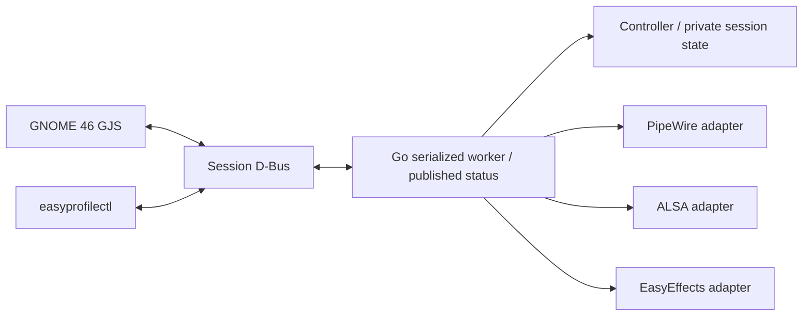

# EasyProfileApp 🎧⚡

Personal audio controller for Ubuntu 24.04 / GNOME Shell 46 Wayland, PipeWire 1.0.5, WirePlumber 0.4.17 and EasyEffects 7.1.6. One Go CLI/daemon and a native GJS extension communicate through Session D-Bus (`org.easyprofile.Daemon`).

The calibrated setup uses AKG K52 front headphones, SP166 rear speakers and the KA-1333 USB microphone. Hardware identities, output routes and preset compatibility are configured in `config.example.json`.

## Safety and behavior

- Output route changes mute the physical sink and both ALSA pins before switching. The inactive pin stays muted; the active route receives its calibrated physical ceiling (AKG ≤97%, SP166 ≤100%). Hardware is released only after readbacks succeed.
- Mic level changes affect the post-DSP source; physical USB gain is untouched. Dual-mute acts independently on the virtual and physical sources, with readback and degraded-state reporting.
- Panic saves three independent mute booleans. Manual mute overrides update the corresponding saved values. Daily reset preserves the two current microphone mute states.
- Volumes and compatible presets are remembered per destination and graphical login. Same-login restart restores them. Corrupt, incomplete or missing same-login state refuses automatic default gains/unmute.
- A process flock is acquired before session loading or hardware initialization. Login authorization is stored atomically before any automatic unmute. Login-marker and audio-state files are separate (`login_session.json` and `session.json`).
- Background reconciliation maintains the virtual default sink, EasyEffects input/output device selections and monitor gain, using fresh identity/readbacks. KA-1333 resolution checks USB identity/profile. Cached IDs are invalidated on graph changes and failed calls.
- Raw microphone captures are reported. Migration is explicit per application, rejects ambiguity and confirms processed links.
- Status reads use an immutable published snapshot, independently of slow hardware operations. UI level requests carry a destination, and route/reset barriers discard pending levels and wait for calls already sent.
- Microphone monitoring (post-DSP sidetone) creates dedicated PipeWire links from `easyeffects_source` to `easyeffects_sink`. A blue headset panel icon indicates active monitoring, and enabling monitoring automatically un-mutes the microphone if muted.
- Temporary whole-output sharing replaces one active call capture's microphone with the selected physical output monitor. The menu switch and `share on|off|toggle` restore the previous capture target on stop. Sharing includes notifications and participants' voices; it cannot run together with mic monitoring. Mic mute, panic, Reset and destination selection stop it. See [behavior and human QA](docs/OUTPUT_SHARING.md).

Automated tests use in-memory audio adapters with `EASYPROFILE_TEST_MODE=1`. No test may control real audio. Production guards and the three calibrated preset files remain untouched during development. Passing local gates does not certify physical routing, sound quality or GNOME Shell behavior.

## Official 17-key keypad contract

| Key | Action | Repeat |
|---|---|---|
| `NumLock` | Audio mode on/off (`⚡`); off restores normal keypad behavior | Native toggle |
| `+` | Focused output/mic volume +1%, clamped to 100% | Yes |
| `-` | Focused output/mic volume −1%, clamped to 0% | Yes |
| `1` | Select AKG K52; focus output | No |
| `2` | Select SP166; focus output | No |
| `3` | Toggle volume focus between output and microphone | No |
| `4` | Select base preset (`BasePreset` / daily approved profile) for the active output | No |
| `5` | Previous preset (circular cycle through all compatible presets) | No |
| `6` | Next preset (circular cycle through all compatible presets) | No |
| `0` | Microphone dual-mute; red panel icon indicates mic mute state | No |
| `.` / `,` | Output mute (`KP_Decimal` / `KP_Separator`) | No |
| `Enter` | Panic: output and microphone mute; toggle restores independent snapshot | No |
| `/` | DynamicEqualizer placeholder; logs intent, no DSP change | No |
| `*` | Daily reset: base preset, output 95%, mic 100%; preserves both mic mutes | No |
| `7` | Toggle post-DSP microphone monitoring (sidetone); blue headset panel icon; auto-unmutes mic | No |
| `8` | Reserved, silent no-op | No |
| `9` | Reserved, silent no-op | No |

NumLock is monitored natively; the other 16 bindings are registered only in audio mode. Only `+`/`-` allow autorepeat. Routine actions produce no OSD; real errors do. Volume labels update locally while confirmation is pending. Icons/mute claims use daemon state rather than assuming hardware success. Restart is available from the menu through systemd only; `*` does not restart the daemon.

## Calibrated EasyEffects output presets (SP166 & AKG K52)

Ten listening-tested output presets for EasyEffects 7.1.6 are versioned in [`presets/output/`](presets/output/), covering five distinct acoustic modes for both Multi/Multilaser SP166 2.1 speakers and AKG K52 closed-back headphones:

| Mode | SP166 Preset | AKG K52 Preset | Intended Use & Acoustic Target |
|---|---|---|---|
| **Padrão** | [`SP166 - Padrão.json`](presets/output/SP166%20-%20Padrão.json) | [`AKG K52 - Padrão.json`](presets/output/AKG%20K52%20-%20Padrão.json) | Daily reference; speech, meetings, classes, and general music |
| **Bass** | [`SP166 - Bass.json`](presets/output/SP166%20-%20Bass.json) | [`AKG K52 - Bass.json`](presets/output/AKG%20K52%20-%20Bass.json) | Low-end impact and weight; electronic, trance, techno, hardstyle, hardtekk |
| **Cinema** | [`SP166 - Cinema.json`](presets/output/SP166%20-%20Cinema.json) | [`AKG K52 - Cinema.json`](presets/output/AKG%20K52%20-%20Cinema.json) | Dialogue clarity and dynamic contrast between speech and action |
| **Jazz** | [`SP166 - Jazz.json`](presets/output/SP166%20-%20Jazz.json) | [`AKG K52 - Jazz.json`](presets/output/AKG%20K52%20-%20Jazz.json) | Open acoustic soundstage, piano, brass, and cymbal air |
| **Rock** | [`SP166 - Rock.json`](presets/output/SP166%20-%20Rock.json) | [`AKG K52 - Rock.json`](presets/output/AKG%20K52%20-%20Rock.json) | Body, guitar/vocal presence, and drum transient punch |

All presets and metadata are indexed in [`presets/manifest.json`](presets/manifest.json).

### DSP chains and calibration

- **SP166 vs. AKG K52 gain staging**: AKG K52 presets apply a calibrated `-2.5 dB` input gain on `equalizer#1` (or `equalizer#0` for Padrão) to match the front-panel headphone mixer ceiling (97%) and headphone sensitivity, whereas SP166 uses `0.0 dB` input gain.
- **Padrão (IIR)**: Minimalist equalizer-only stage without a limiter. SP166 uses 2 parametric bands (250 Hz -1 dB, 2500 Hz +1.5 dB, Q=0.8); AKG preserves its neutral daily reference curve (1791 Hz, gain 0 dB, Q=1.55).
- **Bass (Calf Bass Enhancer)**: `equalizer#1 → bass_enhancer#0 → limiter#0`. Harmonic generation (`amount=10`, `floor=40 Hz`, `scope=100`, `harmonics=4`) on top of the clean daily EQ base. Limiter uses Herm Thin (`threshold -1 dB`, `alr true`, `lookahead 5 ms`, `attack 1 ms`, `release 5 ms`).
- **Cinema (Dialogue Clarity adaptation)**: `filter#0 (18 Hz high-pass IIR x4) → multiband_compressor#0 (splits 120/250/3500/8000 Hz, bands 0–4 active, wet -6 dB parallel, upward compression on band 2) → equalizer#1 → compressor#1 (wideband downward, threshold -22 dB, ratio 1.7, sidechain 150–6000 Hz RMS) → limiter#0 (Herm Thin, threshold -1.5 dB, 8x oversampling Full x8(3L), 24-bit dithering)`.
- **Jazz (GentleDynamics acoustic adaptation)**: `filter#0 (18 Hz high-pass FIR x6) → multiband_compressor#0 (8 active bands, upward/downward dynamic control) → equalizer#1 (4 bands: 250 Hz -1 dB, 400 Hz -1.5 dB, 2500 Hz +2.5 dB, 7000 Hz +2.5 dB) → limiter#0 (Herm Thin, threshold -2 dB, output gain -0.6 dB, 8x oversampling, 24-bit dithering)`.
- **Rock**: `equalizer#1 (4 bands: 110 Hz low-shelf +4 dB, 350 Hz -3 dB, 1600 Hz +3.5 dB, 7000 Hz high-shelf +2.5 dB) → compressor#0 (downward, threshold -16 dB, ratio 1.3, attack 30 ms, release 100 ms) → limiter#0 (Herm Thin, threshold -1 dB, alr true)`. Listening benchmarked against Pantera's *Walk*.

### EasyProfileApp integration

In EasyProfileApp destinations (`config.json`), set `Padrão` as `base_preset` and list the remaining presets alphabetically (`Padrão → Bass → Cinema → Jazz → Rock`):
- Keypad `4`: Instantly selects the base preset (`SP166 - Padrão` or `AKG K52 - Padrão`).
- Keypad `5` / `6`: Circularly cycles previous / next compatible presets.
- Jazz and Rock are also directly selectable from the GNOME Shell tray menu or CLI.

### Preset checksums & installation

| File | Bytes | SHA-256 |
|---|---|---|
| `presets/output/SP166 - Padrão.json` | 1953 | `7802bfbf95d5fe70d1964e6cfca63adc90a86ed26d78837dd45b2f2a3a142f52` |
| `presets/output/SP166 - Bass.json` | 2919 | `65c54cf505aca620350df5a2fbbdcb6004451efc5455ab48a201fde4114deb6b` |
| `presets/output/SP166 - Cinema.json` | 13583 | `4e8a8591effe1728b986a636f30562be33fdf56d8d493f4cd2114ddb6cfc216c` |
| `presets/output/SP166 - Jazz.json` | 14134 | `56f5ff4f92000c56394927f9b9a88d395fce148ae34912e0344201cf7d1c5796` |
| `presets/output/SP166 - Rock.json` | 5054 | `04a1b45f5878866e7bbaa59494483ef093d530e397251b88b39de9a5506b2767` |
| `presets/output/AKG K52 - Padrão.json` | 1228 | `c7af0ffd83f1c7598f477c1789825a321e2a1570309fd5f426b32d39cd57d669` |
| `presets/output/AKG K52 - Bass.json` | 2920 | `5fc282599e8de5e0497db1c92a035c66928f2ebb7a2221cbf06ce5a19db70226` |
| `presets/output/AKG K52 - Cinema.json` | 13584 | `7f3b2d17c789101668655465691337d3236f1bce1ccbf88672f4bd8230bad858` |
| `presets/output/AKG K52 - Jazz.json` | 14135 | `6dfe0e71b2c6aac38e17ecd3ae20d76eb7fef228063825c1303756a9ecaeb732` |
| `presets/output/AKG K52 - Rock.json` | 5055 | `e4b0f067afa5957338fc7cd1d4a128c62291027577b64fdac043afa293d14b5c` |

Presets can be copied to `~/.config/easyeffects/output/` (native package) or imported via the EasyEffects interface.

### Sources & Attributions

- **Cinema & Jazz dynamics**: Adapted from [droidwayin/GentleDynamics](https://github.com/droidwayin/GentleDynamics) (`GentleDynamics Dialogue Clarity Engine.json` and `GentleDynamics.json`, GPL-3.0), customized with personal parametric EQ curves.
- **Bass**: Harmonic generation inspired by exploration of [Rabcor/Heavy-Bass-EE](https://github.com/Rabcor/Heavy-Bass-EE) (Unlicense), tuned without crystallizer or multiband artifacts.
- **Padrão & Rock**: Personal listening curves tailored for the SP166 physical acoustic setup and AKG K52 closed-back headphones.

## Architecture



No HTTP/WebSocket server or second IPC exists. Interfaces describe operations actually used. The controller protects domain invariants; the daemon sequences hardware operations. Session writes are synchronous and atomic, outside the status-read path, and I/O failures are reported.

## Build and isolated verification

Requires Go **1.27.1**, Node.js, GJS, staticcheck, D-Bus tools and GNOME extension packaging/schema tools.

```bash
make build extension-pack
EASYPROFILE_TEST_MODE=1 GSETTINGS_BACKEND=memory go test -race ./...
make quality-gate
```

The six gates cover formatting/vet/staticcheck/build; Go AST subprocess/file-write rules and private Git hygiene; preset/guard integrity and extension packaging; race tests, fake cutover failures and extension lifecycle/concurrency tests; CLI/daemon/shared-GJS-proxy integration on a private bus with no activation directories; captured-dump parse and isolated fake-process performance.

Measured budgets: parser <5 ms/op; direct status read during blocked hardware <5 ms; fake CLI status p95 <15 ms over 100 samples; fake daemon RSS <15 MB; fake idle CPU <1% of one core over 60 seconds. CLI maximum is reported separately. Real adapters, child processes and GNOME still require accompanied measurement. No aggressive CPU quota is claimed or imposed.

## Observation and CLI

**Always pass `--observe` for a daemon run without hardware control.** The default is control mode; omitting this flag is not a read-only test.

```bash
# Read-only audio observation; do not run alongside an existing daemon owning the lock.
bin/easyprofilectl daemon --observe --config config.example.json

# Read-only inspection without starting a daemon
bin/easyprofilectl inspect

# Query the existing daemon
bin/easyprofilectl status --json
```

Control-mode examples below mutate audio and belong only to explicitly accompanied use:

```bash
easyprofilectl volume +1
easyprofilectl mic -1
easyprofilectl mute mic
easyprofilectl mute out
easyprofilectl panic
easyprofilectl listen toggle
easyprofilectl share on
easyprofilectl share off
easyprofilectl route akg
easyprofilectl route sp166
easyprofilectl preset list
easyprofilectl preset next
easyprofilectl preset prev
easyprofilectl preset base
easyprofilectl preset "SP166 - Jazz"
easyprofilectl reset
```

The systemd daemon requires a trustworthy graphical identity (`XDG_SESSION_ID` or `SESSION_MANAGER`) in its environment; stable Wayland/bus socket paths cannot authorize login unmute. `XDG_RUNTIME_DIR` supplies the process lock and separate state files. Lifecycle/configuration methods are not exported on D-Bus. The UI uses `SetVolumeForDestination`; stale destinations are rejected inside the worker.

## Installation and rollback

Development does not authorize executing a real cutover. The installer and rollback are prepared for a separately authorized production session:

- `scripts/install.sh --dry-run` reads hashes and service states without builds, writes or snapshot replacement.
- A real install atomically creates an immutable rollback point. Existing snapshots cause refusal before installation; never delete one blindly to retry.
- An already active EasyProfile service is preserved and causes refusal before installation; this script is not a hot upgrade path.
- After legacy guard deactivation begins, catchable errors/signals trigger rollback. Readiness requires structured JSON health with confirmed protection, no error, DSP bindings and monitor gain confirmed. A received degraded/invalid reply rolls back immediately; only unavailable transport/readiness is retried within a deadline. SIGKILL/power loss cannot execute a shell trap; retain the snapshot for explicit recovery.
- Rollback removes the D-Bus activation file, stops the new daemon, restores each saved active/enabled state symmetrically and verifies all three preset hashes. Missing/corrupt snapshots are errors; there is no guessed enable/start fallback.

See [the current handoff](docs/EP-004-EP-005-HANDOFF.md) and [architecture requirements](ARCHITECTURE_AND_REQUIREMENTS.md) for validation boundaries and the accompanied QA checklist.

## License

MIT © Rafael Albernaz.
